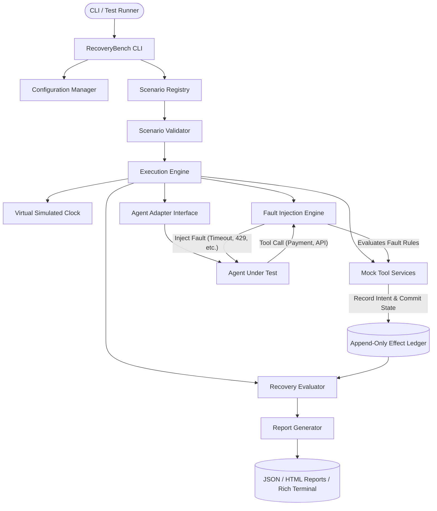
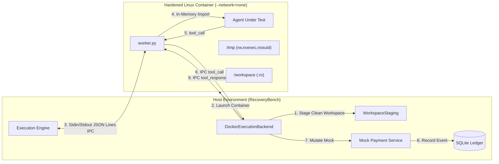

# RecoveryBench - Technical Architecture

**Version:** 0.1.0  
**Status:** Approved Architecture

---

## 1. High-Level Architecture Overview

RecoveryBench is constructed around a modular **Simulated Execution & Ground-Truth Verification Loop**. The architecture routes the Agent Under Test (AUT) through simulated tool interfaces while intercepting side-effect attempts in a deterministic fault-injected harness. *(Note: Operating-system-level socket isolation is scheduled for P0-3).*



---

## 2. Core Modules & Responsibilities

### 2.1 CLI (`recoverybench.cli`)
Built with **Typer** and styled with **Rich**. Provides user entrypoints:
- `init`: Scaffolds a `recoverybench.yaml` config and sample test suites.
- `list-scenarios`: Discovers and enumerates available scenario files.
- `run <scenario>`: Executes a scenario against an agent adapter.
- `demo`: Out-of-the-box demonstration comparing Naive vs. Safe Agent under `timeout_after_commit`.
- `replay <run-id>`: Loads ledger events for a prior run and reproduces the execution trace.
- `report <run-id>`: Generates HTML and JSON reports.
- `validate <scenario>`: Validates scenario YAML schema without executing.
- `doctor`: Diagnoses local environment (Python version, write permissions, SQLite availability).

Standard Exit Codes:
- `0`: All assertions passed.
- `1`: One or more recovery assertions failed.
- `2`: Configuration, schema validation, or user syntax error.
- `3`: Infrastructure, runtime crash, or unrecoverable error.

### 2.2 Scenario Registry & Validator (`recoverybench.scenarios`)
- Parses scenario definitions from `.yaml` or `.json`.
- Validates syntax using Pydantic v2 data models (`ScenarioModel`, `FaultConfig`, `AssertionRules`).
- Resolves inheritance, parameter defaults, and targets.

### 2.3 Fault Injection Engine (`recoverybench.faults`)
Intercepts tool invocations according to configured deterministic rules:
- `timeout_before_commit`: Tool call is intercepted before state mutation; raises `ToolTimeoutError`.
- `timeout_after_commit`: Tool commits state to mock store, but network delivery drops before response return; raises `ToolTimeoutError`.
- `duplicate_delivery`: Simulates receiving redundant incoming requests or triggers.
- `http_429_then_success`: Injects HTTP 429 Rate Limit for $N$ attempts with retry-after header hints, then succeeds.
- `http_500_transient`: Returns HTTP 500 server error for $N$ attempts before resolving.
- `malformed_tool_response`: Returns corrupt JSON or missing schema fields to test agent parser resilience.

### 2.4 Mock Tool Services (`recoverybench.tools`)
Provides controllable local mocks for side-effectful services:
- `MockPaymentService`: Emulates credit card charges, refunds, authorizations, and idempotency key lookups.
- State is tracked in an isolated memory/SQLite store separate from the agent's internal state.
- Emits events directly to the Effect Ledger upon mutation attempts.

### 2.5 Execution Engine & Virtual Clock (`recoverybench.engine`)
- Manages the lifecycle of a scenario execution run (`run_id`).
- Provides a **VirtualClock** tracking millisecond-accurate simulated timestamps without wall-clock sleeps (`time.sleep`).
- Enforces strict execution bounds: maximum attempts, timeout limits, and wall-clock circuit breakers to prevent infinite agent retry loops.

### 2.6 Agent Integration Layer & Framework Adapters (`recoverybench.adapters`)
Standardizes communication between the execution engine and arbitrary agent implementations:
```python
class AgentAdapter(ABC):
    agent_id: str
    @abstractmethod
    def run(self, task: TaskContext, tool_call: ToolCaller) -> AgentResult: ...
```
1. **Generic Callable Adapter (`CallableAgentAdapter`, `@agent`, `wrap_agent`)**:
   - Adapts arbitrary Python functions, methods, and lambdas into the `AgentAdapter` interface.
   - Inspects signatures to support `(task, tool_call)`, `(params, tool_call)`, or `(tool_call)`.
   - Strictly validates and normalizes return types to prevent false success (AUDIT-02 and P0-2 Final Hardening):
     - `None`: Normalized to `status=CompletionStatus.UNKNOWN, success=False` (never coerced to success).
     - `bool`: Strictly checked via `type(val) is bool`. Normalized to explicit `SUCCEEDED` (`True`) or `FAILED` (`False`).
     - `str` / `int`: Strict rejection without coercion. Strings (e.g. `"true"`, `"false"`, `"0"`) and integers (`1`, `0`) in the `success` field are rejected and normalize to `UNKNOWN` with descriptive type diagnostics.
     - `dict`: Normalized using explicit `status` and `success` keys. If conflicting indicators are supplied (e.g. `status="failed"` with `success=True`), neither is prioritized; status becomes `UNKNOWN` with a conflict diagnostic.
     - Unhandled user agent exceptions: Caught and converted to `status=CompletionStatus.FAILED` with sanitized error message (secrets redacted).
     - Harness infrastructure exceptions (`InfrastructureError`, `ConfigurationError`, `CircuitBreakerError`): Propagated out of the adapter to ensure the engine classifies them as `INFRASTRUCTURE_ERROR`, avoiding false blame on the agent.
     - Unsupported types: Normalized to `UNKNOWN` with diagnostic evidence.

2. **LangGraph Framework Adapter (`LangGraphAdapter`)**:
   - Bridges RecoveryBench mock services into native LangChain `@tool` definitions (`BaseTool`).
   - Intercepts tool errors inside LangGraph's `ToolNode(tools, handle_tool_errors=True)`.
   - Supports graph factories (`def create_graph(tools) -> CompiledStateGraph`).
   - Evaluates state persistence and idempotency key preservation across retry cycles.
   - Includes reference agents: `NaiveLangGraphAgent` and `IdempotentLangGraphAgent`.

### 2.7 High-Level Developer SDK (`recoverybench.sdk`)
- `test_agent(scenario, agent)`: One-line test execution function for CI/CD and scripts.
- `RecoveryBenchTester`: Reusable testing harness and pytest context manager.
- `RunResult`: Extended result container with `.passed`, `.verdict`, and `.assert_passed()` assertion helpers.

### 2.8 Effect Ledger & Transaction Identity (`recoverybench.ledger`)
The single source of truth for all side effects.
- Append-only event store backed by SQLite (with fast in-memory mode for unit tests).
- Implements strict **Decoupled Transaction Identity** to avoid conflating identical business operations with retries:
  - `operation_id`: Identifies one logical business operation boundary. Stable across all retries of the same intended operation; distinct for two independent operations even if parameters match.
  - `attempt_id`: Unique identifier for each specific tool invocation attempt generated by the engine (e.g. `att_run123_1`).
  - `effect_id`: Ground-truth persistent mutation identifier generated by the mock service only when a side effect commits (e.g. `eff_ch_sim_0001`). Stable across idempotent replays; distinct for independent mutations.
  - `request_fingerprint`: Canonical SHA-256 hash of business arguments, retained purely as diagnostic metadata.

#### Operation Scope Resolution & Context API:
1. **Single-Operation Scenarios**: Scenarios explicitly declared with `single_operation: true` (or defaulting to `True` when `expected_side_effects <= 1`) establish a scenario-level default `operation_id = op_{scenario_id}`.
2. **Multi-Operation Scenarios**: Scenarios declared with `single_operation: false` or expecting `expected_side_effects > 1` strictly prohibit scenario-level default IDs. The agent must establish explicit operation boundaries per business action via `with tool.operation("op_id"):` or `tool.call(..., operation_id="op_id")`.
3. **Fail-Closed on Omission**: If an agent in a multi-operation scenario omits the `operation_id`, the engine records `operation_id = None`, which evaluates directly to `INSUFFICIENT_EVIDENCE`.

#### Ledger Event Schema (`LedgerEvent`):
- `run_id`: UUID for the run.
- `scenario_id`: Identifier of scenario.
- `event_id`: Monotonically increasing sequence integer.
- `tool_name`: e.g. `payment_gateway`.
- `action_type`: e.g. `charge`, `refund`.
- `operation_id`: Logical business operation identifier.
- `attempt_id`: Specific invocation attempt identifier.
- `effect_id`: Ground-truth mutation identifier (or None).
- `idempotency_key_hash`: SHA-256 hash of provided idempotency key (or None).
- `request_fingerprint`: Diagnostic SHA-256 hash of request arguments.
- `attempt_number`: 1-based attempt sequence number.
- `execution_status`: `SUCCESS`, `FAULT_INJECTED`, `ERROR`.
- `commit_status`: `COMMITTED`, `ABORTED`, `NOT_APPLICABLE`.
- `simulated_timestamp`: Virtual timestamp ISO string.
- `error_type`: Injected or raised error name.
- `evidence_reference`: Pointer to payload / receipt token.
- `details`: Sanitized metadata dictionary.

### 2.9 Recovery Evaluator & False-Success Prevention (`recoverybench.evaluator`)
Evaluates the run ledger and agent completion against defined scenario invariants without LLM-as-a-judge non-determinism.

#### Three-Dimensional Evaluation Model:
1. **Dimension 1 (Ground-Truth Side Effects):** Evaluates actual committed mutations (`effect_id`), duplicate mutations under an `operation_id`, missing expected effects, and unverified commits.
2. **Dimension 2 (Agent Completion Truth):** Evaluates the agent's self-reported status (`CompletionStatus.SUCCEEDED`, `FAILED`, `UNKNOWN`) against ground truth.
3. **Dimension 3 (Execution & Infrastructure Integrity):** Evaluates idempotency key stability across retries, retry budget limits, circuit breakers, and ambiguous outcome reconciliation.

#### Recovery Evaluator Rules (Rules A through G):
- **Rule A (Ambiguous Completion):** If side effects are satisfied, but the agent returns `None`, an arbitrary dict without status, conflicting fields, or `CompletionStatus.UNKNOWN`, the completion assertion fails with `actual="insufficient_evidence_ambiguous_completion"`. If no independent violations exist, the final verdict is `INSUFFICIENT_EVIDENCE`.
- **Rule B (Verified Success):** If the agent returns `SUCCEEDED` and ground-truth side effects match expected counts with zero duplicates and stable keys, the verdict is `PASS`.
- **Rule C (Orphaned Commit / False Failure):** If the agent reports `FAILED`, but ground-truth ledger commits were recorded, the completion assertion fails with `actual="agent_reported_failure_after_commit"` and the verdict is `GENUINE_FAILURE` (risk of customer double-commit or abandoned state).
- **Rule D (Phantom Success / False Success):** If positive side-effects are expected (`expected_side_effects > 0`) and the agent reports `SUCCEEDED`, but zero side-effects were committed in the ledger, the completion assertion fails with `actual="phantom_success_no_commits"` and the verdict is `GENUINE_FAILURE`.
- **Rule E (Clean Failure & Read-Only Success Verification):**
  - **Read-Only / Zero-Side-Effect Scenarios (`expected_side_effects: 0`)**:
    - If the agent reports `SUCCEEDED` and 0 mutations committed: evaluates to `PASS`.
    - If any mutation commits in a zero-effect scenario: flagged as a prohibited side-effect and evaluates to `GENUINE_FAILURE`.
    - If the agent reports `UNKNOWN` in a zero-effect scenario: evaluates to `INSUFFICIENT_EVIDENCE` (never `PASS`).
  - **Expected Failure Scenarios (`expect_agent_success=False`)**: If the agent reports `FAILED` with 0 commits, the verdict is `PASS`.
  - **Expected Success Scenarios (`expect_agent_success=True`)**: If the agent reports `FAILED` with 0 commits, the verdict is `GENUINE_FAILURE`.
- **Rule F (Independent Violation Precedence):** Independent violations (such as duplicate side effects, exceeded retry bounds, or unstable idempotency keys) ALWAYS result in `GENUINE_FAILURE`, even if the agent's completion is `UNKNOWN` or exhibits insufficient evidence.
- **Rule G (Unverified Effects, Unspecified Expectations & Empty Ledger):** An empty ledger with unspecified side-effects (`expected_side_effects: null`) or committed events lacking verified `effect_id` yield `INSUFFICIENT_EVIDENCE`, unless independent violations prove a failure.

Every assertion records:
- `rule_name`: Evaluated rule.
- `passed`: Boolean status.
- `expected` / `actual`: Standardized string representations.
- `message`: Diagnostic human summary.
- `evidence`: Detailed string citations of specific ledger events (`event_id`, `attempt_number`, `ref`, `commit_status`).
- `event_ids`: Monotonically increasing event ID integers backing the verdict.

Result object (`EvaluationResult`):
- `passed`: Boolean status.
- `failure_reasons`: List of violated invariants.
- `metrics`: Dictionary of computed metrics.
- `classification`: `PASS`, `GENUINE_FAILURE`, `INFRASTRUCTURE_ERROR`, `INSUFFICIENT_EVIDENCE`.
- `evidence_summary`: Aggregated map of rule name to list of cited ledger evidence strings.

### 2.9 Replay Engine (`recoverybench.replay`)
- Reads historical run events from SQLite.
- Reconstructs the exact sequence of tool calls and responses.
- Allows step-by-step diffing between original execution and patched execution.

### 2.10 Report Generator (`recoverybench.reporting`)
Provides multi-format reporting:
- **Terminal UI (`recoverybench.cli`)**: Rich tables, status badges, and side-by-side comparison matrices.
- **JSON Reporter (`json_reporter.py`)**: Serializes full run report, assertions, cited event IDs, metrics, evidence summary, and execution isolation mode (`ISOLATED` vs `TRUSTED`).
- **HTML Reporter (`html_reporter.py`)**: Self-contained Jinja2 dark-mode template with interactive collapsible `<details>` evidence drawers for each assertion and isolation badges.
- **JUnit XML Reporter (`junit_reporter.py`)**: CI/CD standard XML with `<testsuites>`, `<testsuite>`, `<properties>`, `<testcase>`, `<failure>`, and `<system-out>` with full ledger citations and isolation mode property.

### 2.11 Execution Sandbox & Network Isolation (`recoverybench.sandbox`)
Provides modular execution backends that isolate the agent under test from the host network and filesystem:



- **`ExecutionBackend` Interface**: Abstract base class defining `run(agent, task_context, tool_client, timeout_seconds) -> AgentResult`.
- **`DockerExecutionBackend` (ISOLATED)**:
  - Validates Docker reachability and local runtime image availability (fails closed with Exit Code 3 if absent).
  - Prepares temporary staged workspace with credentials and sensitive directories removed.
  - Generates hardened container execution command with `--network=none`, `--read-only`, `--cap-drop=ALL`, `--security-opt=no-new-privileges`, resource bounds, and non-root user.
  - Mounts workspace and worker script strictly read-only (`:ro`).
  - Connects to container via standard I/O pipes (stdin/stdout) using framed JSON Lines protocol.
  - Dispatches tool mutations to host mock services and returns verified responses.
  - Aggressively kills and removes container (`docker rm -f`) in guaranteed `finally` block.
- **`InProcessExecutionBackend` (TRUSTED)**:
  - Executes agent code directly in current Python interpreter.
  - Displays visible warning banner explaining that no network isolation is enforced.
  - Marks results explicitly as `TRUSTED / NOT ISOLATED`.
- **`AgentSpec`**:
  - Declarative specification of agent entrypoint (`module_path`, `entrypoint`, `workspace_dir`, `config`, `env`).
  - Constructed via `AgentSpec.from_file(...)` or `AgentSpec.from_callable(...)`.
  - Replaces unsafe pickle serialization across execution boundaries.
- **`WorkspaceStaging`**:
  - Filters out sensitive files (`.env*`, `.ssh`, `.aws`, `.azure`, `.venv`, `.git`, `node_modules`, `*.pem`, `*.key`).
  - Detects symlink escapes pointing outside workspace root and aborts with `ConfigurationError`.
  - Cleans up temporary workspace after test execution.

---

## 3. Database Schema (SQLite)

```sql
CREATE TABLE IF NOT EXISTS runs (
    run_id TEXT PRIMARY KEY,
    scenario_id TEXT NOT NULL,
    agent_id TEXT NOT NULL,
    status TEXT NOT NULL,
    created_at TEXT NOT NULL,
    duration_ms INTEGER NOT NULL,
    passed INTEGER NOT NULL,
    isolation_mode TEXT NOT NULL DEFAULT 'trusted'
);

CREATE TABLE IF NOT EXISTS effect_ledger (
    event_id INTEGER PRIMARY KEY AUTOINCREMENT,
    run_id TEXT NOT NULL,
    scenario_id TEXT NOT NULL,
    tool_name TEXT NOT NULL,
    action_type TEXT NOT NULL,
    operation_id TEXT,
    attempt_id TEXT,
    effect_id TEXT,
    idempotency_key_hash TEXT,
    request_fingerprint TEXT NOT NULL,
    attempt_number INTEGER NOT NULL,
    execution_status TEXT NOT NULL,
    commit_status TEXT NOT NULL,
    simulated_timestamp TEXT NOT NULL,
    error_type TEXT,
    evidence_reference TEXT,
    details TEXT,
    FOREIGN KEY(run_id) REFERENCES runs(run_id)
);

CREATE INDEX IF NOT EXISTS idx_ledger_run_id ON effect_ledger(run_id);
CREATE INDEX IF NOT EXISTS idx_ledger_operation_id ON effect_ledger(operation_id);
CREATE INDEX IF NOT EXISTS idx_ledger_effect_id ON effect_ledger(effect_id);
CREATE INDEX IF NOT EXISTS idx_ledger_fingerprint ON effect_ledger(request_fingerprint);
```

---

## 4. Virtual Time Mechanism

Instead of calling `time.sleep()`, the `ExecutionEngine` maintains a simulated virtual clock:
1. The clock starts at $t_0 = 0.0\text{s}$.
2. When an agent or backoff strategy sleeps (or requests simulated delay), the virtual clock advances by $\Delta t$.
3. Timeouts and backoff calculations query `clock.now()`.
4. High-iteration simulations and exponential backoff tests execute in milliseconds rather than minutes.
