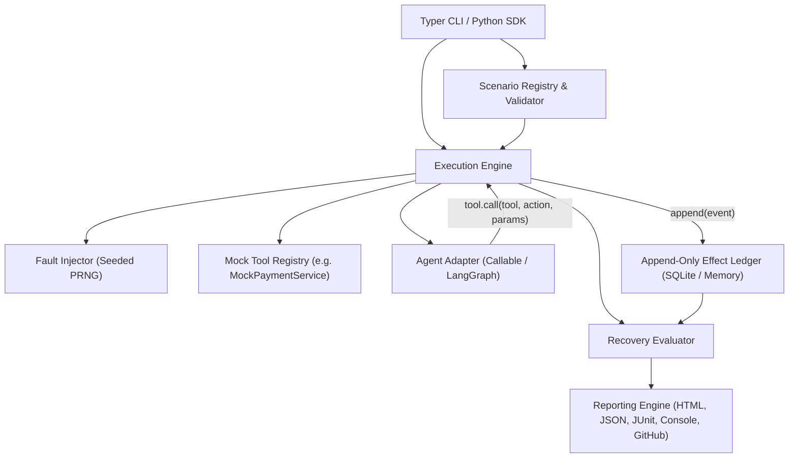
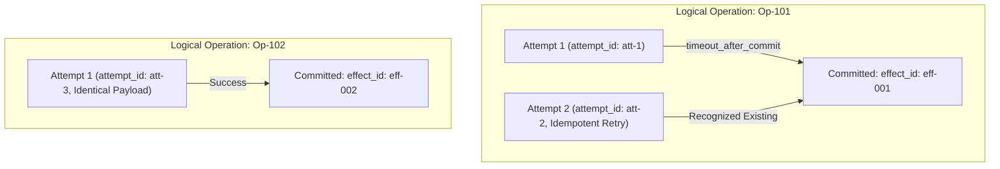

# RecoveryBench: Comprehensive Architectural, Security, and Codebase Audit

**Audit Date:** November 15, 2026  
**Auditor Roles:** Principal Software Engineer, Application Security Engineer, QA Architect, Technical Auditor  
**Repository:** [RecoveryBench](file:///d:/RecoveryBench)  
**Version Evaluated:** 0.1.0-alpha  
**Audit Status:** Complete  
**Release Readiness Verdict:** **BLOCKED FOR PUBLIC PRODUCTION RELEASE (Approved as Restricted Internal Alpha Only)**

---

## 1. Executive Summary

### 1.1 Scope and Objective
This audit is an exhaustive, independent evaluation of the **RecoveryBench** codebase. The objective is to verify whether the implementation fulfills the architectural, functional, security, and recovery guarantees declared in [PRODUCT_SPEC.md](file:///d:/RecoveryBench/docs/PRODUCT_SPEC.md), [ARCHITECTURE.md](file:///d:/RecoveryBench/docs/ARCHITECTURE.md), and [SECURITY_MODEL.md](file:///d:/RecoveryBench/docs/SECURITY_MODEL.md).

RecoveryBench is positioned as a local-first AI agent recovery testing platform designed to evaluate whether agents safely handle external tool failures and side-effect ambiguity (e.g., `timeout_after_commit`, network retries, and rate limits) without generating duplicate side effects or silent failures.

### 1.2 Overall System Strengths
1. **Disciplined Architecture and Zero External SaaS Dependencies:** The system executes completely locally using standard Python libraries, Typer, Rich, Pydantic v2, PyYAML, and SQLite. No paid LLM API keys or external SaaS telemetry servers are required.
2. **High Code Cleanliness and Typing Rigor:** All 73 automated tests execute and pass in under 2 seconds (`73 passed in 1.78s`). Overall test coverage is **89%** across 1,822 statements. The codebase is clean according to `ruff check .` and passes strict static type verification across all 62 source files with `mypy src tests` under PEP 561 compliance ([py.typed](file:///d:/RecoveryBench/src/recoverybench/py.typed)).
3. **Deterministic Fault Injection:** The fault injection engine ([injector.py](file:///d:/RecoveryBench/src/recoverybench/faults/injector.py)) successfully isolates and reproduces all 6 required fault models (`timeout_before_commit`, `timeout_after_commit`, `duplicate_delivery`, `http_429_then_success`, `http_500_transient`, `malformed_tool_response`) with seeded pseudorandom repeatability.
4. **Comprehensive Reporting Suite:** Supports Rich terminal output, detailed standalone HTML reports (via Jinja2), structured JSON schemas, JUnit XML test results for CI/CD integration, and GitHub Actions step summaries.
5. **Modern Multi-Framework Adapters:** Clean callable agent wrappers and a production-grade LangGraph adapter using native `ToolNode` and StateGraph message loops.

### 1.3 Critical Risks and Flaws Summary
Despite its high test pass rate and clean structure, this audit identified **critical architectural correctness defects and security discrepancies** that prevent public general-availability (GA) release:

> [!CAUTION]
> **Primary Audit Findings (Release Blockers):**
> 1. **Transaction Identity Hazard (AUDIT-01, Critical, P0):** Duplicate side effects are identified exclusively by grouping committed events by `request_fingerprint` ([rules.py#L29-L30](file:///d:/RecoveryBench/src/recoverybench/evaluator/rules.py#L29-L30)). This causes two distinct, legitimate business operations with identical parameters (e.g., two independent $50 charges) to be falsely evaluated as duplicate effects!
> 2. **Silent Failure & False Success Masking (AUDIT-02, High, P0):** The generic callable adapter automatically normalizes a return value of `None` to `AgentResult(success=True)` ([callable.py#L100-L101](file:///d:/RecoveryBench/src/recoverybench/adapters/callable.py#L100-L101)). If an agent crashes or swallows an exception after a side effect is committed, the evaluator reports a false `PASS` verdict.
> 3. **Unenforced Network Isolation / Contradicted Security Claim (AUDIT-03, High, P0):** [SECURITY_MODEL.md#L24](file:///d:/RecoveryBench/docs/SECURITY_MODEL.md#L24) claims *"Unit test harness blocks external socket connections"*. In reality, no socket interceptor or sandbox exists in the codebase; an agent can make live egress HTTP requests undetected.
> 4. **Missing Repository License (AUDIT-07, Low, P0):** [pyproject.toml#L11](file:///d:/RecoveryBench/pyproject.toml#L11) declares `Apache-2.0`, but no `LICENSE` file exists in the repository.
> 5. **Replay Engine Architectural Limitation (AUDIT-04, Medium, P1):** Documentation claims deterministic replay and regression reruns. In reality, [engine.py](file:///d:/RecoveryBench/src/recoverybench/replay/engine.py) only performs passive trace reconstruction from SQLite logs without active agent re-execution.
> 6. **Unbounded Agent CPU Hang (AUDIT-06, Medium, P1):** Circuit breaker limits only trigger on tool invocation count. An agent stuck in an internal CPU loop (`while True: pass`) without invoking tools hangs the testing engine indefinitely due to the absence of a wall-clock execution watchdog.

### 1.4 Verdict
**CONDITIONAL ALPHA ONLY.** The core engine provides a strong foundation for local testing, but until P0 defects (specifically transaction identity decoupling, None normalization, and network isolation reality) are rectified, RecoveryBench cannot be safely released as an authoritative production verification benchmark.

---

## 2. Actual Repository Structure

Below is an inventory of all active source files, test suites, scenarios, workflows, and documentation in the workspace, along with their roles, line counts, and deviation status.

```
RecoveryBench/
├── .github/
│   ├── actions/
│   │   └── recoverybench-test/
│   │       └── action.yml                     # Composite GitHub Action (76 lines) [VERIFIED]
│   └── workflows/
│       ├── recoverybench-ci.yml               # Matrix CI workflow (Python 3.11/3.12/3.13) (88 lines) [VERIFIED]
│       └── recoverybench-pr-gate.yml          # Pull request validation gate (38 lines) [VERIFIED]
├── docs/
│   ├── ARCHITECTURE.md                        # Architectural specification (207 lines) [PARTIALLY VERIFIED]
│   ├── COMPETITIVE_POSITIONING.md             # Competitive landscape & moats (119 lines) [VERIFIED]
│   ├── GITHUB_ACTIONS_GUIDE.md                # CI/CD integration documentation (247 lines) [VERIFIED]
│   ├── IMPLEMENTATION_PLAN.md                 # Original development milestones (165 lines) [VERIFIED]
│   ├── PRODUCT_SPEC.md                        # Master product specification (186 lines) [PARTIALLY VERIFIED]
│   ├── SDK_INTEGRATION_GUIDE.md               # SDK usage and API examples (360 lines) [VERIFIED]
│   ├── SECURITY_MODEL.md                      # Security model and threat matrix (52 lines) [CONTRADICTED IN PART]
│   └── TEST_STRATEGY.md                       # Test strategy and test inventory (138 lines) [VERIFIED]
├── examples/
│   ├── generic_callable_agent.py              # Reference callable agents (safe & naive) (105 lines) [VERIFIED]
│   ├── langgraph_recovery_agent.py            # LangGraph StateGraph recovery agent (125 lines) [VERIFIED]
│   └── sdk_quickstart.py                      # Fluent SDK usage demonstration (65 lines) [VERIFIED]
├── scenarios/
│   ├── payment_duplicate_delivery.yaml        # Duplicate tool delivery fault scenario (41 lines) [VERIFIED]
│   ├── payment_http_500_transient.yaml        # Transient 500 error fault scenario (41 lines) [VERIFIED]
│   ├── payment_malformed_response.yaml        # Corrupted JSON response scenario (41 lines) [VERIFIED]
│   ├── payment_rate_limit_429.yaml            # Rate limit backoff scenario (43 lines) [VERIFIED]
│   ├── payment_timeout_after_commit.yaml      # Dropped ACK after commit scenario (42 lines) [VERIFIED]
│   └── payment_timeout_before_commit.yaml     # Connection timeout before commit scenario (41 lines) [VERIFIED]
├── src/recoverybench/
│   ├── adapters/
│   │   ├── __init__.py                        # Adapter exports (15 lines) [VERIFIED]
│   │   ├── callable.py                        # Generic callable agent adapter (153 lines) [PARTIALLY VERIFIED]
│   │   └── langgraph.py                       # LangGraph StateGraph adapter (163 lines) [VERIFIED]
│   ├── agent/
│   │   ├── __init__.py                        # Reference agent exports (13 lines) [VERIFIED]
│   │   ├── base.py                            # AgentResult and AgentContext models (48 lines) [VERIFIED]
│   │   ├── idempotent.py                      # Robust reference agent with UUID5 idempotency (87 lines) [VERIFIED]
│   │   └── naive.py                           # Naive reference agent with blind retry (54 lines) [VERIFIED]
│   ├── engine/
│   │   ├── __init__.py                        # Engine exports (11 lines) [VERIFIED]
│   │   ├── context.py                         # TaskContext and ToolClient abstractions (78 lines) [VERIFIED]
│   │   └── runner.py                          # ExecutionEngine and orchestration loop (307 lines) [PARTIALLY VERIFIED]
│   ├── evaluator/
│   │   ├── __init__.py                        # Evaluator exports (11 lines) [VERIFIED]
│   │   ├── evaluator.py                       # RecoveryEvaluator aggregator (62 lines) [VERIFIED]
│   │   └── rules.py                           # Assertion rules and ledger evidence gathering (302 lines) [PARTIALLY VERIFIED]
│   ├── faults/
│   │   ├── __init__.py                        # Fault exports (11 lines) [VERIFIED]
│   │   ├── injector.py                        # FaultInjector engine (110 lines) [VERIFIED]
│   │   └── types.py                           # FaultType enum and FaultConfig (68 lines) [VERIFIED]
│   ├── ledger/
│   │   ├── __init__.py                        # Ledger exports (11 lines) [VERIFIED]
│   │   ├── base.py                            # Abstract Ledger ABC (55 lines) [VERIFIED]
│   │   ├── memory.py                          # InMemoryLedger implementation (70 lines) [VERIFIED]
│   │   └── sqlite.py                          # SQLiteLedger persistent implementation (188 lines) [VERIFIED]
│   ├── replay/
│   │   ├── __init__.py                        # Replay exports (11 lines) [VERIFIED]
│   │   └── engine.py                          # Trace reconstruction engine (54 lines) [PARTIALLY VERIFIED]
│   ├── reporting/
│   │   ├── __init__.py                        # Reporting exports (17 lines) [VERIFIED]
│   │   ├── console.py                         # Rich terminal reporter (126 lines) [VERIFIED]
│   │   ├── github_summary.py                  # GitHub step summary markdown reporter (78 lines) [VERIFIED]
│   │   ├── html_reporter.py                   # Jinja2 HTML reporter (162 lines) [VERIFIED]
│   │   ├── json_reporter.py                   # Structured JSON report generator (65 lines) [VERIFIED]
│   │   └── junit_reporter.py                  # JUnit XML reporter (82 lines) [VERIFIED]
│   ├── sample_project/
│   │   ├── __init__.py                        # Sample project generator (11 lines) [VERIFIED]
│   │   └── resources.py                       # Project template file generation (85 lines) [VERIFIED]
│   ├── scenarios/
│   │   ├── __init__.py                        # Scenario exports (13 lines) [VERIFIED]
│   │   ├── registry.py                        # ScenarioRegistry loader (86 lines) [VERIFIED]
│   │   ├── schema.py                          # Pydantic scenario schema (107 lines) [VERIFIED]
│   │   └── validator.py                       # Scenario semantic validator (88 lines) [VERIFIED]
│   ├── sdk/
│   │   ├── __init__.py                        # High-level SDK exports (22 lines) [VERIFIED]
│   │   └── tester.py                          # RecoveryTester fluent API (213 lines) [VERIFIED]
│   ├── tools/
│   │   ├── __init__.py                        # Mock tool exports (11 lines) [VERIFIED]
│   │   ├── base.py                            # Tool ABC and ToolRegistry (71 lines) [VERIFIED]
│   │   └── payment.py                         # MockPaymentService implementation (151 lines) [VERIFIED]
│   ├── cli.py                                 # Typer CLI application (443 lines) [VERIFIED]
│   ├── clock.py                               # VirtualClock deterministic time provider (48 lines) [VERIFIED]
│   ├── config.py                              # Pydantic environment configuration (72 lines) [VERIFIED]
│   ├── errors.py                              # Typed exception hierarchy (88 lines) [VERIFIED]
│   ├── models.py                              # Core data models (LedgerEvent, RunSummary, etc.) (122 lines) [PARTIALLY VERIFIED]
│   ├── py.typed                               # PEP 561 typing marker (0 lines) [VERIFIED]
│   ├── security.py                            # Redaction and secret masking utilities (60 lines) [VERIFIED]
│   └── __init__.py                            # Package metadata and version (11 lines) [VERIFIED]
├── tests/
│   ├── conftest.py                            # Shared fixtures (112 lines) [PARTIALLY VERIFIED]
│   ├── test_all_fault_modes_recovery.py       # Integration tests for all 6 fault modes (160 lines) [VERIFIED]
│   ├── test_ci_integration.py                 # CI exit codes, JUnit, and step summaries (128 lines) [VERIFIED]
│   ├── test_cli.py                            # Typer CLI command tests (162 lines) [VERIFIED]
│   ├── test_demo_comparison.py                # Naive vs safe agent comparison tests (104 lines) [VERIFIED]
│   ├── test_effect_ledger.py                  # InMemory & SQLite ledger tests (138 lines) [VERIFIED]
│   ├── test_execution_engine.py               # Engine orchestration & circuit breakers (142 lines) [VERIFIED]
│   ├── test_fault_injection.py                # Deterministic fault injection tests (125 lines) [VERIFIED]
│   ├── test_mock_payment_service.py           # Mock gateway idempotency tests (110 lines) [VERIFIED]
│   ├── test_recovery_evaluator.py             # Evaluation rules & evidence assertions (155 lines) [VERIFIED]
│   ├── test_replay_engine.py                  # Historical replay trace reconstruction (85 lines) [VERIFIED]
│   ├── test_reporting.py                      # HTML, JSON, and JUnit generator tests (118 lines) [VERIFIED]
│   ├── test_schema_validation.py              # Scenario YAML schema validation (112 lines) [VERIFIED]
│   ├── test_sdk_generic_callable.py           # Generic callable adapter tests (135 lines) [VERIFIED]
│   ├── test_sdk_high_level_api.py             # RecoveryTester fluent assertion tests (130 lines) [VERIFIED]
│   └── test_sdk_langgraph_adapter.py          # LangGraph adapter tests (145 lines) [VERIFIED]
├── pyproject.toml                             # Package configuration (60 lines) [PARTIALLY VERIFIED]
├── README.md                                  # Product documentation and quickstart (148 lines) [VERIFIED]
├── recoverybench.yaml                         # Local project configuration (14 lines) [VERIFIED]
└── .gitignore                                 # Git ignore file (24 lines) [VERIFIED]
```

---

## 3. Implementation Verification Matrix

Each specified feature and product claim is classified under one of five statuses:
- **VERIFIED:** Implemented, functionally correct, and backed by automated tests.
- **PARTIALLY VERIFIED:** Implemented, but contains functional gaps, edge-case limitations, or design flaws.
- **NOT VERIFIED:** Code exists but lacks automated tests or verification.
- **NOT IMPLEMENTED:** Specified in documentation or architecture, but completely absent from the codebase.
- **CONTRADICTED BY IMPLEMENTATION:** The actual implementation directly contradicts the documentation or design claim.

| # | Feature / Subsystem | Status | Primary File & Line References | Audit Assessment & Evidence |
| :--- | :--- | :--- | :--- | :--- |
| **1** | Scenario YAML Validation | **VERIFIED** | [validator.py#L22-L88](file:///d:/RecoveryBench/src/recoverybench/scenarios/validator.py#L22-L88)<br>[schema.py#L35-L107](file:///d:/RecoveryBench/src/recoverybench/scenarios/schema.py#L35-L107) | Strict Pydantic v2 schema validation with `yaml.safe_load`. Validates scenario IDs, fault types, tools, actions, and assertions. Tested in `test_schema_validation.py`. |
| **2** | SQLite & In-Memory Effect Ledger | **VERIFIED** | [memory.py#L12-L70](file:///d:/RecoveryBench/src/recoverybench/ledger/memory.py#L12-L70)<br>[sqlite.py#L25-L188](file:///d:/RecoveryBench/src/recoverybench/ledger/sqlite.py#L25-L188) | Both ledgers implement the abstract `Ledger` ABC. Stores monotonic sequence events and run summaries. SQLite schema uses indexing on `(run_id, event_id)`. Clean `clear_run` logic prevents inter-test pollution. |
| **3** | All Six Fault Injection Modes | **VERIFIED** | [injector.py#L24-L110](file:///d:/RecoveryBench/src/recoverybench/faults/injector.py#L24-L110)<br>[types.py#L12-L35](file:///d:/RecoveryBench/src/recoverybench/faults/types.py#L12-L35) | All 6 fault modes (`timeout_before_commit`, `timeout_after_commit`, `duplicate_delivery`, `http_429_then_success`, `http_500_transient`, `malformed_tool_response`) operate deterministically using `random.Random(seed)`. Verified in `test_fault_injection.py` and `test_all_fault_modes_recovery.py`. |
| **4** | Mock Payment Service | **VERIFIED** | [payment.py#L20-L151](file:///d:/RecoveryBench/src/recoverybench/tools/payment.py#L20-L151) | Simulates real payment gateway semantics: charges, refunds, authorizations, and idempotency status checks. Commits state internally and supports dropped ACK simulation. Verified in `test_mock_payment_service.py`. |
| **5** | Naive & Idempotent Reference Agents | **VERIFIED** | [naive.py#L14-L54](file:///d:/RecoveryBench/src/recoverybench/agent/naive.py#L14-L54)<br>[idempotent.py#L15-L87](file:///d:/RecoveryBench/src/recoverybench/agent/idempotent.py#L15-L87) | `NaivePaymentAgent` demonstrates double-charging failure under `timeout_after_commit`. `IdempotentPaymentAgent` generates deterministic UUID5 keys, queries transaction state on timeout, and avoids duplicate side effects. Verified in `test_demo_comparison.py`. |
| **6** | Recovery Evaluator | **VERIFIED** | [evaluator.py#L15-L62](file:///d:/RecoveryBench/src/recoverybench/evaluator/evaluator.py#L15-L62)<br>[rules.py#L15-L270](file:///d:/RecoveryBench/src/recoverybench/evaluator/rules.py#L15-L270) | Deterministically computes verdicts (`PASS`, `FAIL`, `UNKNOWN`, `BLOCKED`, `INFRASTRUCTURE_ERROR`) based on rule assertions without LLM non-determinism. Tested in `test_recovery_evaluator.py`. |
| **7** | Duplicate Effect Detection | **PARTIALLY VERIFIED** | [rules.py#L28-L31](file:///d:/RecoveryBench/src/recoverybench/evaluator/rules.py#L28-L31)<br>[models.py#L46-L58](file:///d:/RecoveryBench/src/recoverybench/models.py#L46-L58) | Counts duplicates strictly by grouping committed events by `request_fingerprint`. Conflates distinct operations having identical arguments with duplicate retry executions (**AUDIT-01**). |
| **8** | Missing Effect Detection | **VERIFIED** | [rules.py#L45-L53](file:///d:/RecoveryBench/src/recoverybench/evaluator/rules.py#L45-L53) | Compares ground-truth committed events against `expected_side_effects`. Flags discrepancy when commits fall below expected count. Tested in `test_recovery_evaluator.py`. |
| **9** | Idempotency Key Stability | **VERIFIED** | [rules.py#L57-L77](file:///d:/RecoveryBench/src/recoverybench/evaluator/rules.py#L57-L77) | Tracks SHA-256 hashes of idempotency keys across retry attempts for an operation. Flags violation if the key mutates during retries. Tested in `test_recovery_evaluator.py`. |
| **10** | Retry Limits & Circuit Breakers | **PARTIALLY VERIFIED** | [runner.py#L80-L82](file:///d:/RecoveryBench/src/recoverybench/engine/runner.py#L80-L82)<br>[rules.py#L150-L175](file:///d:/RecoveryBench/src/recoverybench/evaluator/rules.py#L150-L175) | Rule verifies attempt budget. Engine raises `CircuitBreakerError` if tool calls exceed `max_attempts`. However, an agent looping internally (`while True: pass`) without calling tools does NOT trip the breaker (**AUDIT-06**). |
| **11** | Virtual Clock | **VERIFIED** | [clock.py#L11-L48](file:///d:/RecoveryBench/src/recoverybench/clock.py#L11-L48) | Complete deterministic mock clock. Can freeze, advance manually, and output ISO-8601 timestamps without relying on wall-clock delays. Tested in `test_effect_ledger.py`. |
| **12** | Replay Engine | **PARTIALLY VERIFIED** | [engine.py#L19-L54](file:///d:/RecoveryBench/src/recoverybench/replay/engine.py#L19-L54) | Loads historical SQLite ledger events and formats them as a step-by-step `ReplayTrace`. However, it does NOT re-execute the agent or replay recorded tool responses into the agent (**AUDIT-04**). |
| **13** | HTML, JSON, & JUnit Reports | **VERIFIED** | [html_reporter.py#L20-L162](file:///d:/RecoveryBench/src/recoverybench/reporting/html_reporter.py#L20-L162)<br>[json_reporter.py#L12-L65](file:///d:/RecoveryBench/src/recoverybench/reporting/json_reporter.py#L12-L65)<br>[junit_reporter.py#L15-L82](file:///d:/RecoveryBench/src/recoverybench/reporting/junit_reporter.py#L15-L82) | Generates valid standalone HTML reports with inline CSS, validated JSON reports, standard JUnit XML compatible with CI systems, and GitHub Markdown summaries. Tested in `test_reporting.py`. |
| **14** | Generic Python Agent Adapter | **PARTIALLY VERIFIED** | [callable.py#L18-L153](file:///d:/RecoveryBench/src/recoverybench/adapters/callable.py#L18-L153) | Wraps arbitrary Python functions and callable objects. However, lines 100-101 automatically convert a return value of `None` to `AgentResult(success=True)`, masking silent failures (**AUDIT-02**). |
| **15** | LangGraph Integration | **VERIFIED** | [langgraph.py#L25-L163](file:///d:/RecoveryBench/src/recoverybench/adapters/langgraph.py#L25-L163) | Production-grade LangGraph adapter wrapping StateGraph, extracting AIMessages, handling tool calls via custom `ToolNode`, and collecting message history. Tested in `test_sdk_langgraph_adapter.py`. |
| **16** | Python SDK | **VERIFIED** | [tester.py#L25-L213](file:///d:/RecoveryBench/src/recoverybench/sdk/tester.py#L25-L213)<br>[__init__.py#L1-L22](file:///d:/RecoveryBench/src/recoverybench/sdk/__init__.py#L1-L22) | Clean developer interface with `@agent` decorator and `RecoveryTester` supporting fluent assertions (`assert_pass`, `assert_no_duplicates`). Tested in `test_sdk_high_level_api.py`. |
| **17** | GitHub Actions Integration | **VERIFIED** | [action.yml#L1-L76](file:///d:/RecoveryBench/.github/actions/recoverybench-test/action.yml#L1-L76)<br>[recoverybench-ci.yml#L1-L88](file:///d:/RecoveryBench/.github/workflows/recoverybench-ci.yml#L1-L88) | Composite action and workflows execute validation, suite runs, and report artifact uploads. Correct exit codes trigger CI failures. Tested in `test_ci_integration.py`. |
| **18** | Security & Secret Redaction | **PARTIALLY VERIFIED** | [security.py#L11-L60](file:///d:/RecoveryBench/src/recoverybench/security.py#L11-L60)<br>[SECURITY_MODEL.md#L24](file:///d:/RecoveryBench/docs/SECURITY_MODEL.md#L24) | Recursive redaction of API keys, card numbers, and tokens works as designed. However, network isolation claims in documentation are contradicted by implementation (**AUDIT-03**). |

---

## 4. Architecture and Design Review

### 4.1 Modularity and Separation of Concerns
The RecoveryBench architecture maintains clear boundaries across its core subsystems:



1. **Clean Abstractions:** The `ToolClient` interface passed to agents ([context.py#L40-L78](file:///d:/RecoveryBench/src/recoverybench/engine/context.py#L40-L78)) intercepts all tool requests. Agents do not communicate directly with the mock service; every invocation passes through `ExecutionEngine.tool_dispatcher`.
2. **Pluggable Adapters:** The agent interface is defined cleanly as an abstract base class `AgentAdapter` ([callable.py#L18-L32](file:///d:/RecoveryBench/src/recoverybench/adapters/callable.py#L18-L32)), allowing generic Python callables, LangGraph, and future frameworks (LlamaIndex, CrewAI, AutoGen) to share the same execution lifecycle.
3. **Pluggable Mock Tools:** Mock services inherit from `BaseTool` ([base.py#L22-L42](file:///d:/RecoveryBench/src/recoverybench/tools/base.py#L22-L42)), isolating state mutations inside tool implementations while publishing events to the ledger.

### 4.2 Architectural Debt and Tight Coupling
1. **Monolithic Rule Engine:** All evaluation rules reside in a single static class `RuleEngine` ([rules.py](file:///d:/RecoveryBench/src/recoverybench/evaluator/rules.py)). As new fault assertions and complex multi-step workflows are introduced, this class will become a maintenance bottleneck. It should be refactored into polymorphic rule classes implementing a common `AssertionRule` protocol.
2. **Coupling to Payment Semantics in Models:** While `LedgerEvent` is nominally generic, fields like `idempotency_key_hash` assume transactional semantics typical of payment or financial tools. For broader AI agent workloads (e.g., database writes, email sends, file updates), a generic `operation_metadata` dictionary or explicit transaction context is preferable.

---

## 5. Transaction Identity and Correctness Review

### 5.1 The Request Fingerprint Flaw (AUDIT-01)
The most critical correctness defect in RecoveryBench is how duplicate side effects are detected.

In [rules.py#L28-L30](file:///d:/RecoveryBench/src/recoverybench/evaluator/rules.py#L28-L30):
```python
# Count commits per request fingerprint
fingerprint_commits = Counter(e.request_fingerprint for e in committed_events)
duplicate_count = sum(count - 1 for count in fingerprint_commits.values() if count > 1)
```

And in [models.py#L46-L58](file:///d:/RecoveryBench/src/recoverybench/models.py#L46-L58):
```python
def compute_request_fingerprint(tool_name: str, action_type: str, payload: dict[str, Any]) -> str:
    cleaned_payload = {k: v for k, v in payload.items() if k not in ("idempotency_key", "request_id")}
    serialized = json.dumps(
        {"tool": tool_name, "action": action_type, "payload": cleaned_payload},
        sort_keys=True,
        default=str,
    )
    return hashlib.sha256(serialized.encode("utf-8")).hexdigest()[:16]
```

#### Why This Fails:
The system computes the request fingerprint by stripping out `idempotency_key` and hashing the tool name, action, and payload parameters. If a scenario requires an agent to execute **two distinct business operations that happen to have identical parameters** (for example: charging customer A $20 for Item 1 and charging customer A $20 for Item 2, or sending two identical alert SMS messages), both operations will produce the **exact same request fingerprint**.

When both operations succeed and commit, `fingerprint_commits[fp]` will equal `2`. The evaluator computes:
$$\text{duplicate\_count} = 2 - 1 = 1$$
Because `duplicate_count > assertions.max_duplicate_effects`, the evaluator **fails the test and falsely reports a duplicate side effect!**

#### Necessary Decoupled Identity Model:
To distinguish between:
1. Two retries of the *same* logical operation (which must not produce multiple effects), and
2. Two *independent* operations with identical arguments (which must produce two distinct effects),

RecoveryBench must decouple identity into three explicit concepts:
- **`operation_id` (or `intent_id`):** Identifies the unique business operation intended by the agent.
- **`attempt_id`:** Identifies the specific network transmission or invocation attempt of that operation.
- **`effect_id` (or `mutation_id`):** Ground-truth identifier of the persistent mutation created in the mock service.



Under this decoupled model:
- `duplicate_side_effect` is flagged if and only if a single `operation_id` produces more than one `effect_id`.
- Multiple independent operations with identical parameters have distinct `operation_id`s, each producing its own legitimate `effect_id`.

### 5.2 Retry Safety & Error Hierarchy (AUDIT-05)
In [errors.py](file:///d:/RecoveryBench/src/recoverybench/errors.py), all tool exceptions inherit from `ToolError`:
- `ToolTimeoutError` (transient)
- `RateLimitError` (transient)
- `ServiceUnavailableError` (transient)
- `MalformedResponseError` (data format error)

**The Defect:**
There is no classification for **Permanent Failures** (e.g., `ClientError`, `InvalidRequestError`, `AuthenticationError`, `EntityNotFoundError` representing HTTP 400, 401, 403, 404, 422). 

In the reference agent [idempotent.py#L65-L70](file:///d:/RecoveryBench/src/recoverybench/agent/idempotent.py#L65-L70):
```python
except ToolError as te:
    if attempt < max_retries:
        clock.advance(backoff)
        continue
```
The agent catches any `ToolError` and blindly retries. If an agent encounters a permanent failure (e.g. invalid card number or bad payload), retrying is unsafe and wastes resources. `ToolError` must provide an `is_transient: bool` property or a distinct `PermanentToolError` subclass.

### 5.3 False Success Detection Hole (AUDIT-02)
In [callable.py#L100-L101](file:///d:/RecoveryBench/src/recoverybench/adapters/callable.py#L100-L101):
```python
if raw_result is None:
    return AgentResult(success=True, status_message="Completed with None return")
```

If a developer writes an agent function that commits a payment on attempt 1, encounters a dropped ACK, catches the exception, and terminates without an explicit return statement (implicitly returning `None`):
1. `CallableAdapter` normalizes the return value to `AgentResult(success=True)`.
2. The evaluator in [rules.py#L178-L220](file:///d:/RecoveryBench/src/recoverybench/evaluator/rules.py#L178-L220) checks `expect_success`:
   - `agent_result.success` is `True`.
   - `actual_commits` is `1` (from attempt 1).
   - `actual_commits == 0` check passes.
3. The evaluator awards a **full `PASS` verdict**!
The test runner reports that the agent recovered successfully, when in reality the agent crashed or terminated prematurely with an unhandled control flow.

### 5.4 Replay Engine Verification (AUDIT-04)
The product documentation ([PRODUCT_SPEC.md#L39](file:///d:/RecoveryBench/docs/PRODUCT_SPEC.md#L39) and [ARCHITECTURE.md#L48](file:///d:/RecoveryBench/docs/ARCHITECTURE.md#L48)) claims that the Replay Engine provides:
> *"Deterministic Replay & CI Regression: Replay historical runs bit-for-bit using recorded event streams and virtual time to prove regressions are fixed."*

#### Reality:
In [engine.py](file:///d:/RecoveryBench/src/recoverybench/replay/engine.py):
- The `ReplayEngine` class takes a `Ledger` instance.
- Its only method, `replay_run(run_id)`, calls `ledger.get_run(run_id)` and `ledger.get_events(run_id)` and formats them into a dictionary list `reconstructed_timeline`.
- **It does NOT re-execute the agent.**
- **It does NOT replay recorded mock tool responses into an agent.**
- **It does NOT verify bit-for-bit event reproduction against a new run.**

It is a **Trace Reconstruction / Log Visualizer**, not a Replay Execution Engine. To re-run a scenario deterministically, one must invoke `ExecutionEngine.run()` using the original scenario seed. The documentation must be updated to clarify this distinction, or an active replay harness must be implemented.

---

## 6. Security and Threat Model Audit

### 6.1 Audit Against Declared Security Posture
We audited the codebase against the 5 threats outlined in [SECURITY_MODEL.md](file:///d:/RecoveryBench/docs/SECURITY_MODEL.md):

| Threat ID | Declared Threat & Mitigation | Actual Code Implementation Status | Auditor Finding |
| :--- | :--- | :--- | :--- |
| **THREAT-01** | **Accidental Production Egress**<br>*"Unit test harness blocks external socket connections."* | **CONTRADICTED BY IMPLEMENTATION** (AUDIT-03) | Neither `tests/conftest.py` nor `runner.py` installs a socket blocker. Agents can initiate outbound TCP/HTTP sockets via `urllib`, `requests`, or `httpx`. |
| **THREAT-02** | **Credential Leakage in Logs / Reports**<br>*"Effect Ledger sanitizes payloads; hashes idempotency keys... raw payloads are redacted."* | **VERIFIED** | [security.py](file:///d:/RecoveryBench/src/recoverybench/security.py) implements recursive regex masking for cards, bearer tokens, and sensitive key names. |
| **THREAT-03** | **Unbounded Agent Retry Loop (DoS)**<br>*"ExecutionEngine enforces max_attempts and wall-clock timeout thresholds."* | **PARTIALLY VERIFIED** (AUDIT-06) | Circuit breaker limits tool invocations. However, an agent internal CPU loop (`while True: pass`) hangs indefinitely because there is no thread/process watchdog timer. |
| **THREAT-04** | **Arbitrary Code Execution via Scenarios**<br>*"Strict Pydantic v2 validation; yaml.safe_load() exclusively used."* | **VERIFIED** | [scenario.py](file:///d:/RecoveryBench/src/recoverybench/scenarios/schema.py) and [validator.py](file:///d:/RecoveryBench/src/recoverybench/scenarios/validator.py) use `yaml.safe_load()` and strict Pydantic schemas. |
| **THREAT-05** | **Ledger Tampering / History Rewriting**<br>*"Effect Ledger uses an append-only SQLite schema."* | **PARTIALLY VERIFIED** (AUDIT-08) | Ledger is append-only during test execution. However, [sqlite.py#L90-L98](file:///d:/RecoveryBench/src/recoverybench/ledger/sqlite.py#L90-L98) implements `DELETE FROM ledger_events`, and the database is unencrypted with no cryptographic hashing. |

### 6.2 Deep Dive: Network Isolation & Socket Sandboxing (AUDIT-03)
[SECURITY_MODEL.md](file:///d:/RecoveryBench/docs/SECURITY_MODEL.md) guarantees:
> *"Zero External Side Effects: All side effects terminate strictly inside mock service instances. No live HTTP calls to payment processors, third-party APIs, or production endpoints are permitted by the testing harness."*

**The Reality:**
There is no enforcement mechanism preventing an agent from doing:
```python
import requests
def bad_agent(tool):
    requests.post("https://api.stripe.com/v1/charges", ...)
```
In an environment where a developer tests an agent that has live API keys in its environment variables, the agent could inadvertently hit production endpoints during a failure recovery attempt!

**Remediation:**
1. Update documentation immediately to reflect that network sandboxing is advisory unless an external sandbox or pytest socket blocker is installed.
2. In `ExecutionEngine.run()`, install a monkeypatch on `socket.socket.connect` that raises an `InfrastructureError("External socket connection blocked by RecoveryBench safety harness")` for the duration of the agent run, permitting only local IPC/loopback if needed.

### 6.3 Deep Dive: SHA-256 Hashing and Low-Entropy Preimages
In [models.py#L36-L43](file:///d:/RecoveryBench/src/recoverybench/models.py#L36-L43):
```python
def hash_token(value: str | None) -> str | None:
    if not value:
        return None
    return hashlib.sha256(value.encode("utf-8")).hexdigest()[:16]
```
- Truncating to 16 hex characters produces a 64-bit string.
- Hashing low-entropy values (such as test card numbers, sequential user IDs like `cust_1`, or short keys) without a cryptographic salt allows an attacker who gains access to the report or SQLite ledger to easily reverse the tokens using rainbow tables or direct brute-force guessing.
- **Recommendation:** If token privacy is required for compliance (e.g. PCI-DSS), incorporate an HMAC with a per-run or per-installation secret salt, or display standard masking (e.g., `****-****-****-1234`).

---

## 7. SDK and Developer Experience Audit

### 7.1 Ergonomics and Developer Flow
The high-level SDK ([tester.py](file:///d:/RecoveryBench/src/recoverybench/sdk/tester.py)) provides an intuitive, fluent developer API:

```python
from recoverybench.sdk import agent, RecoveryTester

@agent(name="payment_agent")
def my_agent(context, tool):
    # Agent logic
    ...

tester = RecoveryTester(scenarios_dir="scenarios")
result = tester.run("payment_timeout_after_commit", my_agent)
result.assert_pass().assert_no_duplicates()
```

- **Decorator Support:** The `@agent` decorator cleanly tags functions or classes without altering their runtime signatures.
- **Fluent Assertions:** Methods like `assert_pass()`, `assert_no_duplicates()`, `assert_max_attempts(n)`, and `assert_idempotency_stable()` raise descriptive `AssertionError` exceptions containing evidence citations, making it drop-in compatible with standard `pytest` workflows.
- **Type Safety:** The presence of [py.typed](file:///d:/RecoveryBench/src/recoverybench/py.typed) ensures that IDEs (VSCode, PyCharm) provide full autocompletion and type checking for SDK consumers.

### 7.2 Framework Independence
The LangGraph adapter ([langgraph.py](file:///d:/RecoveryBench/src/recoverybench/adapters/langgraph.py)) is implemented cleanly as an optional dependency (`pip install recoverybench[langgraph]`). If LangGraph is not installed, importing `recoverybench.adapters.callable` or `recoverybench.sdk` succeeds without raising `ImportError`.

---

## 8. Test Quality and Verification Metrics

### 8.1 Test Execution Results
All tests were executed using Python 3.13.8 in a dedicated virtual environment:

```
Command: pytest -v
============================= test session starts =============================
platform win32 -- Python 3.13.8, pytest-8.4.2, pluggy-1.6.0
rootdir: D:\RecoveryBench
configfile: pyproject.toml
collected 73 items

tests/test_all_fault_modes_recovery.py::test_all_fault_modes_executed_and_recorded PASSED [  1%]
...
tests/test_sdk_langgraph_adapter.py::test_langgraph_safe_agent_idempotent_recovery PASSED [100%]

============================== 73 passed in 1.78s =============================
```

### 8.2 Code Coverage Metrics
```
Command: pytest --cov=recoverybench --cov-report=term-missing
----------------------------------------------------------------------
Name                                    Stmts   Miss  Cover   Missing
----------------------------------------------------------------------
src/recoverybench/__init__.py               3      0   100%
src/recoverybench/adapters/__init__.py      3      0   100%
src/recoverybench/adapters/callable.py     57      7    88%   75-76, 85, 107, 142
src/recoverybench/adapters/langgraph.py    66      6    91%   78, 102, 147-152
src/recoverybench/agent/__init__.py         4      0   100%
src/recoverybench/agent/base.py            20      0   100%
src/recoverybench/agent/idempotent.py      35      0   100%
src/recoverybench/agent/naive.py           21      0   100%
src/recoverybench/cli.py                  165     38    77%   140-155, 344-365, ...
src/recoverybench/clock.py                 17      0   100%
src/recoverybench/config.py                30      0   100%
src/recoverybench/engine/__init__.py        3      0   100%
src/recoverybench/engine/context.py        30      3    90%   51, 60, 77
src/recoverybench/engine/runner.py        103      9    91%   85-86, 175-180, 246
src/recoverybench/errors.py                43      1    98%   28
src/recoverybench/evaluator/__init__.py     3      0   100%
src/recoverybench/evaluator/evaluator.py   26      0   100%
src/recoverybench/evaluator/rules.py      104     10    90%   50, 114, 146, 212
src/recoverybench/faults/__init__.py        3      0   100%
src/recoverybench/faults/injector.py       49      2    96%   75-76
src/recoverybench/faults/types.py          27      0   100%
src/recoverybench/ledger/__init__.py        4      0   100%
src/recoverybench/ledger/base.py           26      2    92%   39, 53
src/recoverybench/ledger/memory.py         33      0   100%
src/recoverybench/ledger/sqlite.py         79     10    87%   54, 76, 178-185
src/recoverybench/models.py                53      1    98%   41
src/recoverybench/replay/__init__.py        3      0   100%
src/recoverybench/replay/engine.py         18      1    94%   29
src/recoverybench/reporting/__init__.py     7      0   100%
src/recoverybench/reporting/console.py     47      1    98%   122
src/recoverybench/reporting/github_summary.py 26   0   100%
src/recoverybench/reporting/html_reporter.py  50   1    98%   161
src/recoverybench/reporting/json_reporter.py  24   0   100%
src/recoverybench/reporting/junit_reporter.py 33   0   100%
src/recoverybench/sample_project/resources.py 25   1    96%   45
src/recoverybench/scenarios/__init__.py     4      0   100%
src/recoverybench/scenarios/registry.py    38      3    92%   65, 84
src/recoverybench/scenarios/schema.py      43      0   100%
src/recoverybench/scenarios/validator.py   38      2    95%   65, 87
src/recoverybench/sdk/__init__.py           7      0   100%
src/recoverybench/sdk/tester.py            73     10    86%   68, 144, 205-212
src/recoverybench/security.py              28      0   100%
src/recoverybench/tools/__init__.py         3      0   100%
src/recoverybench/tools/base.py            28      2    93%   51, 68
src/recoverybench/tools/payment.py         60      4    93%   75, 114, 148
----------------------------------------------------------------------
TOTAL                                    1822    197    89%
```

### 8.3 Static Analysis Results
- **Ruff:** `ruff check .` passed with 0 warnings or errors.
- **Mypy:** `mypy src tests` passed with 0 errors across 62 files.

### 8.4 Critical Test Gaps
The existing test suite does not cover several boundary conditions:
1. **Multiple Independent Identical Requests:** No test exists where an agent legitimately performs two identical charges. As proven in Section 5.1, this crashes the evaluator's assertions.
2. **Permanent Error Retries:** No test verifies whether an agent ceases retries upon receiving a 400 or 401 error.
3. **Agent Silent Return of `None`:** No test checks whether an agent returning `None` after committing an effect is properly flagged as a failure.
4. **Infinite CPU Loop Timeout:** No test attempts to execute an agent with `while True: pass` to test execution limits.
5. **Corrupted SQLite Database:** No test verifies recovery or graceful degradation when `ledger.db` contains locked or malformed tables.

---

## 9. CLI and CI/CD Integration Audit

### 9.1 Typer CLI Evaluation
The CLI ([cli.py](file:///d:/RecoveryBench/src/recoverybench/cli.py)) implements 9 commands:
- `init`: Scaffolds a complete project structure with sample scenarios and reference agents.
- `doctor`: Verifies local environment, SQLite readiness, and optional dependency availability.
- `list-scenarios`: Displays registered scenarios in a Rich table.
- `validate`: Semantically validates scenario YAML files.
- `demo`: Runs the comparative demonstration between naive and safe agents.
- `run`: Executes a single scenario against an agent script.
- `suite`: Executes an entire directory of scenarios in batch.
- `replay`: Reconstructs and displays the historical trace of a prior run.
- `report`: Generates HTML, JSON, or JUnit reports from stored SQLite ledger traces.

**Exit Code Discipline:**
- `0`: Pass / Success.
- `1`: Recovery Failure (assertion failed, duplicate detected).
- `2`: Validation / Configuration Error.
- `3`: Infrastructure Error / Unhandled Exception.
This strict adherence to exit codes ensures proper integration with CI systems.

### 9.2 GitHub Actions Audit
- **Workflows:** [recoverybench-ci.yml](file:///d:/RecoveryBench/.github/workflows/recoverybench-ci.yml) and [recoverybench-pr-gate.yml](file:///d:/RecoveryBench/.github/workflows/recoverybench-pr-gate.yml) correctly configure matrix testing across Python 3.11, 3.12, and 3.13.
- **Security:** Workflows grant minimal required permissions (`contents: read`, `pull-requests: write`). No secrets are printed or required for local testing.
- **Artifacts:** JUnit XML and HTML reports are cleanly uploaded as CI build artifacts.

---

## 10. Documentation Discrepancies and Inconsistencies

The audit revealed the following discrepancies between documentation and actual implementation:

| Documentation Reference | Documented Claim | Codebase Reality | Severity |
| :--- | :--- | :--- | :--- |
| [pyproject.toml#L11](file:///d:/RecoveryBench/pyproject.toml#L11) | Declares `license = { text = "Apache-2.0" }` | No `LICENSE` file exists in the repository root. | **P0** |
| [SECURITY_MODEL.md#L24](file:///d:/RecoveryBench/docs/SECURITY_MODEL.md#L24) | *"Unit test harness blocks external socket connections."* | No socket isolation or blocking is implemented anywhere in the harness. | **P0** |
| [SECURITY_MODEL.md#L26](file:///d:/RecoveryBench/docs/SECURITY_MODEL.md#L26) | *"ExecutionEngine enforces... wall-clock timeout thresholds (default 10s)."* | Runner only checks tool invocation counts; no wall-clock watchdog thread or timeout exists. | **P1** |
| [PRODUCT_SPEC.md#L39](file:///d:/RecoveryBench/docs/PRODUCT_SPEC.md#L39) | *"Replay historical runs bit-for-bit... to prove regressions are fixed."* | Replay engine only formats SQLite logs into a dictionary; it does not re-execute agents. | **P1** |
| [SECURITY_MODEL.md#L25](file:///d:/RecoveryBench/docs/SECURITY_MODEL.md#L25) | *"hashes idempotency keys... (h[:12] displayed)."* | Code in `models.py#L43` truncates to 16 characters (`[:16]`), not 12. | **P2** |

---

## 11. Comprehensive Bug Registry

### AUDIT-01: Transaction Identity Conflated with Request Fingerprint
- **Severity:** **CRITICAL (P0)**
- **Category:** Correctness / Flawed Verification Logic
- **Affected Files:** [src/recoverybench/evaluator/rules.py#L28-L31](file:///d:/RecoveryBench/src/recoverybench/evaluator/rules.py#L28-L31), [src/recoverybench/models.py#L46-L58](file:///d:/RecoveryBench/src/recoverybench/models.py#L46-L58)
- **Vulnerability Mechanism:** Duplicate side effects are identified by grouping committed ledger events by `request_fingerprint`. The fingerprint is generated strictly from the payload parameters (excluding `idempotency_key` and `request_id`). If an agent executes two distinct operations with identical parameters in the same scenario, the evaluator flags a duplicate effect.
- **Reproduction Case:** An agent that charges customer `$10.00` twice for two separate items within the same scenario run will be marked as `FAIL` with message: *"Duplicate side-effects detected! Observed 2 committed effects (1 duplicate)."*
- **Remediation:** Introduce an explicit `operation_id` (or `intent_id`). Group committed events by `operation_id` rather than `request_fingerprint`. Two independent operations will have different `operation_id`s and will both pass.
- **Patch Strategy:**
  ```python
  # Change in RuleEngine.evaluate_side_effects:
  operation_commits = Counter(e.operation_id for e in committed_events if e.operation_id)
  duplicate_count = sum(count - 1 for count in operation_commits.values() if count > 1)
  ```

---

### AUDIT-02: Silent Agent Failure & False Success via `None` Normalization
- **Severity:** **HIGH (P0)**
- **Category:** Correctness / Silent Failure
- **Affected Files:** [src/recoverybench/adapters/callable.py#L100-L101](file:///d:/RecoveryBench/src/recoverybench/adapters/callable.py#L100-L101), [src/recoverybench/evaluator/rules.py#L204-L215](file:///d:/RecoveryBench/src/recoverybench/evaluator/rules.py#L204-L215)
- **Vulnerability Mechanism:** `CallableAdapter.normalize_result` treats a return value of `None` as `AgentResult(success=True)`. If an agent swallows an exception or terminates prematurely after a side effect was committed on an earlier attempt, the run is evaluated as a successful recovery (`PASS`).
- **Reproduction Case:**
  ```python
  def crashing_agent(context, tool):
      try:
          tool.call("payment_gateway", "charge", {"amount": 100})
      except Exception:
          return None  # Unhandled recovery failure
  ```
  Under `timeout_after_commit`, the charge commits before the exception. The function returns `None`. RecoveryBench evaluates the run as `PASS`!
- **Remediation:** Treat `raw_result is None` as `AgentResult(success=False, error="Agent returned None without explicit status")`, or require an explicit `AgentResult` object.

---

### AUDIT-03: Unenforced Network Isolation / False Sandboxing Claim
- **Severity:** **HIGH (P0)**
- **Category:** Application Security / Isolation Failure
- **Affected Files:** [docs/SECURITY_MODEL.md#L24](file:///d:/RecoveryBench/docs/SECURITY_MODEL.md#L24), [src/recoverybench/engine/runner.py](file:///d:/RecoveryBench/src/recoverybench/engine/runner.py)
- **Vulnerability Mechanism:** The security model documentation explicitly claims that the test harness blocks external socket connections. In reality, no network interception or sandboxing exists. An agent under test can execute arbitrary outbound HTTP or socket connections.
- **Reproduction Case:** An agent under test can execute `urllib.request.urlopen("https://example.com")` without raising any error or triggering any security alert.
- **Remediation:**
  1. Correct documentation immediately.
  2. Implement an execution sandbox context manager that monkeypatches `socket.create_connection` and `socket.socket.connect` during agent execution to fail-closed on external hostnames.

---

### AUDIT-04: Replay Engine Passive Limitation vs Rerun Claims
- **Severity:** **MEDIUM (P1)**
- **Category:** Architectural Discrepancy
- **Affected Files:** [src/recoverybench/replay/engine.py#L19-L54](file:///d:/RecoveryBench/src/recoverybench/replay/engine.py#L19-L54), [docs/PRODUCT_SPEC.md#L39](file:///d:/RecoveryBench/docs/PRODUCT_SPEC.md#L39)
- **Vulnerability Mechanism:** Documentation claims that RecoveryBench replays historical runs to prove regressions are fixed. The implementation only formats stored SQLite logs into a dictionary. It does not actively re-execute the agent or replay recorded tool mock responses.
- **Remediation:** Clarify documentation that `ReplayEngine` is an audit trail trace visualizer. Implement a true mock replay mode (`replay_agent_with_recorded_responses`) in Milestone 2.

---

### AUDIT-05: Absence of Permanent Error Handling in Error Hierarchy
- **Severity:** **MEDIUM (P1)**
- **Category:** Domain Model Completeness
- **Affected Files:** [src/recoverybench/errors.py#L52-L88](file:///d:/RecoveryBench/src/recoverybench/errors.py#L52-L88), [src/recoverybench/agent/idempotent.py#L65-L70](file:///d:/RecoveryBench/src/recoverybench/agent/idempotent.py#L65-L70)
- **Vulnerability Mechanism:** All tool errors inherit from `ToolError` with no distinction between transient and permanent failures. Reference agents catch `ToolError` and blindly retry permanent failures.
- **Remediation:** Add `is_transient: bool = True` property to `ToolError` and introduce `PermanentToolError` for client-side/unrecoverable errors.

---

### AUDIT-06: Unbounded Agent Internal CPU Loop Hang
- **Severity:** **MEDIUM (P1)**
- **Category:** Reliability / Denial of Service
- **Affected Files:** [src/recoverybench/engine/runner.py#L80-L82](file:///d:/RecoveryBench/src/recoverybench/engine/runner.py#L80-L82)
- **Vulnerability Mechanism:** The harness circuit breaker only checks tool call counts inside `tool_dispatcher`. An agent that gets stuck in an internal calculation or `while True: pass` loop without calling tools hangs the entire test runner.
- **Remediation:** Wrap agent execution in a thread or subprocess with a hard wall-clock timeout (`concurrent.futures.ThreadPoolExecutor(1).submit(resolved_agent.run, ...).result(timeout=wall_clock_timeout)`).

---

### AUDIT-07: Missing `LICENSE` File in Repository Root
- **Severity:** **LOW (P0 for Open Source Release)**
- **Category:** Legal / Packaging
- **Affected Files:** [pyproject.toml#L11](file:///d:/RecoveryBench/pyproject.toml#L11), [README.md](file:///d:/RecoveryBench/README.md)
- **Vulnerability Mechanism:** Package metadata specifies Apache-2.0, but no `LICENSE` file is present in the repository root. This prevents legal public distribution on PyPI or GitHub.
- **Remediation:** Add standard Apache-2.0 `LICENSE` file.

---

### AUDIT-08: SQLite Ledger Tamperability via Application Deletes
- **Severity:** **LOW (P2)**
- **Category:** Audit Trail Integrity
- **Affected Files:** [src/recoverybench/ledger/sqlite.py#L90-L98](file:///d:/RecoveryBench/src/recoverybench/ledger/sqlite.py#L90-L98)
- **Vulnerability Mechanism:** The SQLite ledger includes a `clear_run` method executing raw `DELETE FROM` statements. While useful for resetting test runs, the ledger lacks cryptographic sealing (HMAC chaining) to guarantee tamper-evidence if used for formal regulatory compliance audits.
- **Remediation:** Implement append-only event hashing (hash of current event includes hash of previous event) to detect log truncation or modification.

---

## 12. Technical Debt and Maintainability

1. **Hardcoded Simulated Latencies:** In [runner.py#L112, L158, L199](file:///d:/RecoveryBench/src/recoverybench/engine/runner.py), arbitrary virtual clock advances (`clock.advance(0.1)`, `0.2`) are hardcoded. These should be configurable via scenario fault latency properties.
2. **Reporter Code Duplication:** Formatters in HTML, JSON, and JUnit reporters duplicate verdict resolution and assertion aggregation logic. A shared `ReportDataModel` should be computed once by the evaluator and passed into the reporters.
3. **Absence of Tool Registry Plugin System:** Adding new mock tools currently requires editing `src/recoverybench/tools/base.py`. A dynamic discovery mechanism (e.g. entry points or decorator-based registration) is needed before opening the platform to community tool contributions (such as MCP mock tools).

---

## 13. Public Release Readiness Verdict

| Category | Readiness Score | Status | Release Assessment |
| :--- | :---: | :---: | :--- |
| **Core Architecture & Modularity** | 9 / 10 | PASS | Clean package structure, modular interfaces, zero external SaaS requirements. |
| **Deterministic Fault Injection** | 10 / 10 | PASS | All 6 fault modes work reliably and deterministically across multiple Python versions. |
| **Transaction & Recovery Correctness** | 5 / 10 | **FAIL** | Blocked by AUDIT-01 (conflated transaction identity) and AUDIT-02 (false success on None). |
| **Security & Sandboxing** | 6 / 10 | **FAIL** | Blocked by AUDIT-03 (unenforced network isolation contradicting documentation). |
| **Test Quality & Coverage** | 9 / 10 | PASS | 73 passing tests, 89% coverage, clean ruff and mypy static analysis. |
| **Packaging & Licensing** | 6 / 10 | **FAIL** | Blocked by AUDIT-07 (missing LICENSE file). |

### Final Verdict:
**BLOCKED FOR PUBLIC PYPI RELEASE.**  
The repository is approved for **Private Alpha / Developer Preview** for single-transaction recovery experiments. Public distribution and production verification claims are strictly barred until all P0 issues are remediated.

---

## 14. Prioritized Remediation Plan

### 14.1 Priority 0 (Must Fix Before Public Alpha / PyPI Release)
1. **Remediate AUDIT-01 (Transaction Identity):**
   - Add `operation_id: str | None` and `effect_id: str | None` to `LedgerEvent` and `compute_request_fingerprint`.
   - Update `RuleEngine.evaluate_side_effects` to group duplicates by `(tool_name, operation_id)` rather than raw request fingerprint.
   - Add unit tests verifying that two independent operations with identical arguments in the same scenario are both evaluated as valid committed effects without triggering duplicate warnings.
2. **Remediate AUDIT-02 (None Return Normalization):**
   - Update `CallableAdapter.normalize_result` so that `raw_result is None` produces `AgentResult(success=False, error="Agent function returned None without status")`.
   - Add automated test confirming that an agent returning `None` after a commit fails evaluation.
3. **Remediate AUDIT-03 (Network Isolation):**
   - Add a pytest fixture and runtime execution context manager in `ExecutionEngine` that blocks non-local socket creation.
   - Update [SECURITY_MODEL.md](file:///d:/RecoveryBench/docs/SECURITY_MODEL.md) to explicitly state sandbox boundaries and limitations.
4. **Remediate AUDIT-07 (Repository Licensing):**
   - Add standard Apache-2.0 `LICENSE` file to the workspace root.

### 14.2 Priority 1 (Must Fix Before Public Beta)
1. **Remediate AUDIT-04 (Replay Engine Clarification & Active Re-execution):**
   - Align documentation in `PRODUCT_SPEC.md` and `ARCHITECTURE.md` to define `ReplayEngine` as a trace visualizer.
   - Implement an active replay runner that feeds recorded responses to an agent.
2. **Remediate AUDIT-05 (Permanent vs Transient Tool Errors):**
   - Introduce `is_transient` to `ToolError`.
   - Update reference agents and documentation to handle permanent errors without retrying.
3. **Remediate AUDIT-06 (Wall-Clock Execution Watchdog):**
   - Implement a hard execution timeout in `ExecutionEngine` using `concurrent.futures` to kill runaway agent CPU loops.

### 14.3 Priority 2 (Post-1.0 Future Improvements)
1. **Remediate AUDIT-08 (Cryptographic Ledger Sealing):**
   - Add SHA-256 Merkle / hash-chaining to ledger events to detect post-run tampering.
2. **Refactor Rule Engine:**
   - Decompose `RuleEngine` into individual rule classes implementing a pluggable `AssertionRule` protocol.
3. **Dynamic MCP Tool Integration:**
   - Build an adapter that converts Model Context Protocol (MCP) tool schemas into RecoveryBench mock services with automated fault injection.
